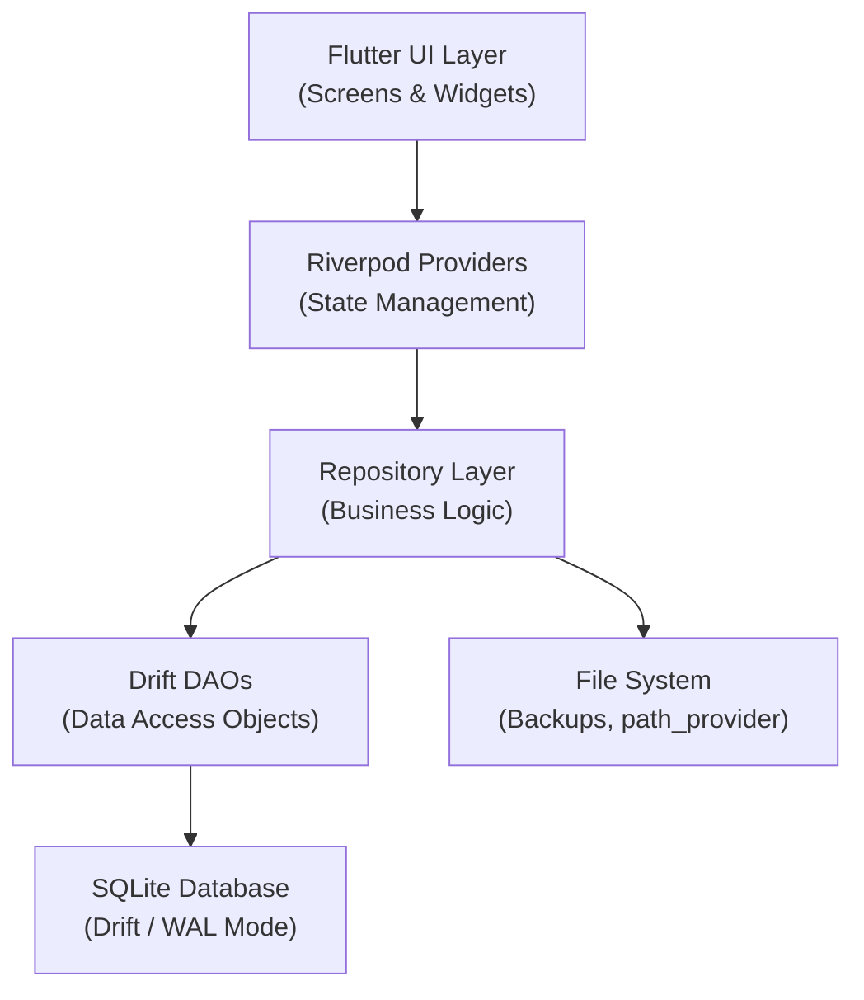

# System Architecture — রজব ভূমি সেবা ঘর

> **Status:** Phase 0 & 1 Complete — Backend Pending
> **Last Updated:** 2026-11-08
> **Source of truth for architecture decisions. See PUKU.md for engineering rules.**

---

## 1. Architecture Overview

রজব ভূমি সেবা ঘর is a fully offline, single-user, single-device Flutter Android application. It follows a **feature-based layered architecture** with Drift (SQLite ORM) for persistence, Riverpod v2 for state management, and GoRouter for navigation.



---

## 2. Layer Responsibilities

### 2.1 UI Layer (`presentation/`)
- Flutter Widgets and Screens only.
- No direct database access.
- No business logic (calculations, validation rules) in UI.
- Consumes Riverpod providers via `ref.watch()` and `ref.read()`.
- Renders `AsyncValue` states: loading, data, error.
- **Existing screens are complete (Phases 0–1). Backend wiring is the remaining work.**

### 2.2 Provider Layer (`providers/`)
- Riverpod v2 `AsyncNotifierProvider`, `NotifierProvider`, `StreamProvider`, or `FutureProvider`.
- Bridges UI and repositories.
- Handles loading, error, and data states.
- Never contains raw SQL or database references.
- Never contains UI rendering logic.

### 2.3 Repository Layer (`data/repositories/`)
- Pure Dart business logic.
- Calls DAOs to read/write data.
- Wraps multi-table operations in Drift transactions.
- Converts DAO results to domain model objects.
- Enforces business rules (duplicate prevention, snapshot writing, soft delete logic).

### 2.4 DAO Layer (`data/daos/`)
- Drift `DatabaseAccessor` subclasses.
- Type-safe SQL queries using Drift's query builder.
- One DAO per table or logical group.
- No business logic in DAOs — only data access.

### 2.5 Database Layer (`core/database/`)
- Drift `AppDatabase` class.
- All table definitions.
- Schema version and migration strategy.
- PRAGMAs: `foreign_keys = ON`, `journal_mode = WAL`.
- Singleton initialized once at startup.

---

## 3. Feature Module Structure

Each feature follows this exact directory pattern:

```
lib/features/<feature>/
├── data/
│   ├── models/
│   │   └── <entity>_model.dart       — Immutable Dart model
│   ├── daos/
│   │   └── <entity>_dao.dart         — Drift DAO
│   └── repositories/
│       └── <entity>_repository.dart  — Business logic + repository
├── presentation/
│   ├── screens/
│   │   └── <screen>_screen.dart      — Flutter screen (EXISTS — do not redesign)
│   └── widgets/
│       └── <widget>.dart             — Feature-specific widget (EXISTS — do not redesign)
└── providers/
    └── <feature>_provider.dart       — Riverpod provider
```

---

## 4. Database Architecture

### 4.1 Initialization Sequence
```
App launch
  → WidgetsFlutterBinding.ensureInitialized()
  → AppDatabase.open()
    → PRAGMA foreign_keys = ON
    → PRAGMA journal_mode = WAL
    → Run pending migrations (if any)
  → ProviderScope (AppDatabase injected as provider)
  → MaterialApp → MainShellScreen
```

### 4.2 Database Provider
```dart
// lib/core/database/database_provider.dart
final appDatabaseProvider = Provider<AppDatabase>((ref) {
  final db = AppDatabase();
  ref.onDispose(() => db.close());
  return db;
});
```

### 4.3 Schema Overview
See `docs/DATABASE_SCHEMA.md` for the complete schema specification.

**14 Tables:**
- `applications`, `persons`, `references`, `offices`
- `payments`, `expenses`, `independent_incomes`, `status_history`
- `documents`, `tasks`
- `work_types`, `expense_categories`, `income_categories`
- `shop_settings`

**1 View:**
- `unified_transactions_view` — Centralized ledger view combining all transaction sources

---

## 5. State Management Architecture

### 5.1 Provider Hierarchy
```
AppDatabase (singleton)
  ↓
Feature DAOs (injected into repositories)
  ↓
Feature Repositories (pure Dart business logic)
  ↓
Feature Providers (Riverpod AsyncNotifier / Notifier)
  ↓
UI Screens (Consumer / ref.watch)
```

### 5.2 Provider Naming Convention
```dart
// Lists / queries
final applicationsProvider = AsyncNotifierProvider<ApplicationsNotifier, List<ApplicationModel>>(...)
final activePersonsProvider = FutureProvider<List<PersonModel>>(...)

// Single item
final applicationDetailProvider = FutureProvider.family<ApplicationModel?, String>((ref, id) => ...)

// Financial summaries
final financialSummaryProvider = AsyncNotifierProvider<FinancialSummaryNotifier, FinancialSummary>(...)

// Shop settings
final shopSettingsProvider = AsyncNotifierProvider<ShopSettingsNotifier, ShopSettings>(...)
```

---

## 6. Navigation Architecture

### 6.1 Current State
`app.dart` uses `MaterialApp` with `home: MainShellScreen()`. GoRouter is in `pubspec.yaml` but not yet wired.

### 6.2 Target State (Phase 7 — UI Integration)
GoRouter will be introduced with named routes. The 5-tab shell will be a `ShellRoute`. All screen-to-screen navigation within features will use `context.go()` or `context.push()`.

**Route naming convention:**
```
/                           → Dashboard
/applications               → Application List
/applications/create        → Create Application
/applications/:id           → Application Detail
/applications/:id/edit      → Edit Application
/finance                    → Financial Overview
/finance/payment/create     → Payment Form
/finance/income/create      → Income Form
/finance/expense/create     → Expense Form
/finance/transactions       → Transaction History
/finance/dues               → Due Management
/analytics                  → Analytics Dashboard
/menu                       → More Menu
/persons                    → Person List
/persons/create             → Create Person
/persons/:id                → Person Detail
/offices                    → Office Management
/tasks                      → Task List
/tasks/create               → Create Task
/tasks/:id                  → Task Detail
/references                 → Reference List
/references/:id             → Reference Detail
/backup                     → Backup & Restore
/settings/categories        → Category Management
/documents/:id              → Document Viewer
```

---

## 7. Backup Architecture

See `PUKU.md` Section 14 and `docs/PROJECT_PLAN.md` Section 3.6 for the complete backup strategy.

**Summary:**
1. WAL checkpoint → DB file copy → integrity check → optional AES-256 encryption → export to Downloads
2. Optional: encrypted upload to Telegram via Bot API
3. Restore: file selection → decrypt → integrity check → replace live DB → verify

---

## 8. Data Flow: Application Creation

```
User fills 3-step wizard
  → Step 1: Applicant info (name, phone, address) + optional person lookup
  → Step 2: Work type, office, date, mouza, app number, case number
  → Step 3: Reference selection, agreed amount, initial payment, documents, notes

On Submit:
  → ApplicationRepository.createApplication(...)
    → DB transaction:
      1. applications.insert(
           applicant_id: person?.id,
           applicant_name: formData.name,      ← SNAPSHOT
           applicant_phone: formData.phone,    ← SNAPSHOT
           applicant_address: formData.address, ← SNAPSHOT
           reference_id: reference?.id,
           reference_name: reference?.name,    ← SNAPSHOT
           office_id: office.id,
           office_name: office.name,           ← SNAPSHOT
           work_type: formData.workType,
           application_date: ...,
           status: 'আবেদন',
           agreed_amount: formData.agreedAmount.paisa,
           ...
         )
      2. If initialPayment > 0:
           payments.insert(application_id: newApp.id, amount: initialPayment.paisa, ...)
      3. If documents selected:
           documents.insertAll([...])
  → Provider invalidated → UI refreshes
```

---

## 9. Data Flow: Financial Totals Calculation

```
FinancialSummaryRepository.getGlobalSummary(dateFilter)
  → Query unified_transactions_view (or separate aggregate queries)
    → total_app_income   = SUM WHERE type='income' AND source IN ('applicationPayment', 'statusIncome')
    → total_ind_income   = SUM WHERE type='income' AND source = 'independentIncome'
    → total_app_expense  = SUM WHERE type='expense' AND source IN ('applicationExpense', 'statusExpense')
    → total_gen_expense  = SUM WHERE type='expense' AND source = 'generalExpense'
  → Return FinancialSummary(
      grandTotalIncome: Money.fromPaisa(total_app_income + total_ind_income),
      grandTotalExpense: Money.fromPaisa(total_app_expense + total_gen_expense),
      netBusinessIncome: Money.fromPaisa((total_app_income + total_ind_income) - (total_app_expense + total_gen_expense)),
      ...
    )
```

---

## 10. Document Storage Flow

```
User selects PDF or image (via file_picker)
  → Read file bytes → check size (warn if > 5MB)
  → DocumentRepository.saveDocument(applicationId, fileName, fileType, bytes)
    → documents.insert(
        application_id: applicationId,
        file_name: fileName,
        file_type: 'pdf' | 'image',
        file_data: bytes (BLOB),
        file_size: humanReadableSize,
        created_at: now.millisecondsSinceEpoch,
      )
  → Provider invalidated → Documents tab refreshes

User views document:
  → DocumentRepository.getDocumentData(documentId)
    → SELECT file_data FROM documents WHERE id = ? AND deleted_at IS NULL
  → Return bytes → DocumentViewerScreen renders PDF/image
```

---

## 11. Known Technical Decisions

See `docs/architecture/TECHNICAL_DECISIONS.md` for the full decision log.

| Decision | Choice | Reason |
|---|---|---|
| ORM | Drift | Type-safe SQL, compile-time verification, DAOs, migrations, WAL |
| State Management | Riverpod v2 | Type-safe, testable, excellent for offline-first |
| Money type | Custom `Money` class (int paisa) | Prevents double arithmetic errors |
| Primary keys | UUID v4 (TEXT) | Conflict-free offline operation |
| Soft delete | `deleted_at INTEGER NULL` | Audit trail, calculation immunity, easy restore |
| Snapshots | Denormalized snapshot columns in `applications` | Historical accuracy when linked records change |
| Routing | GoRouter | Declarative, deep-link support (to be wired in Phase 7) |

